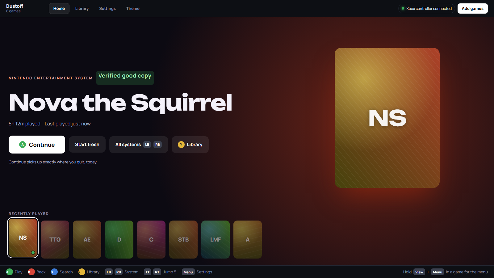
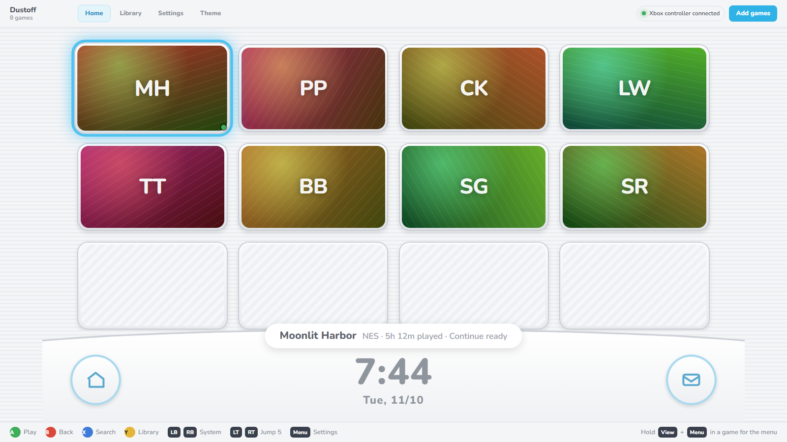
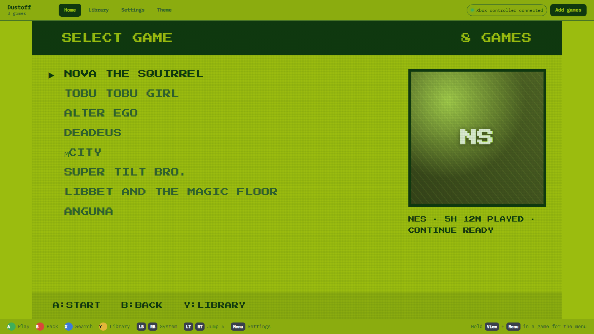
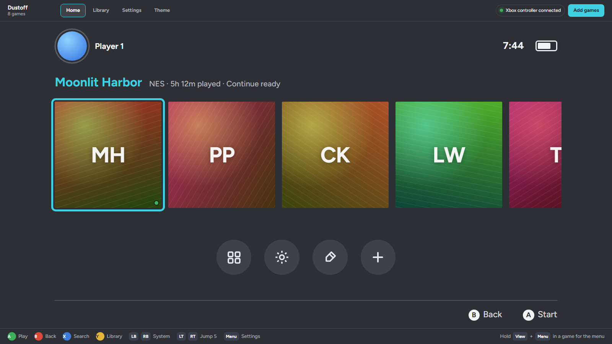
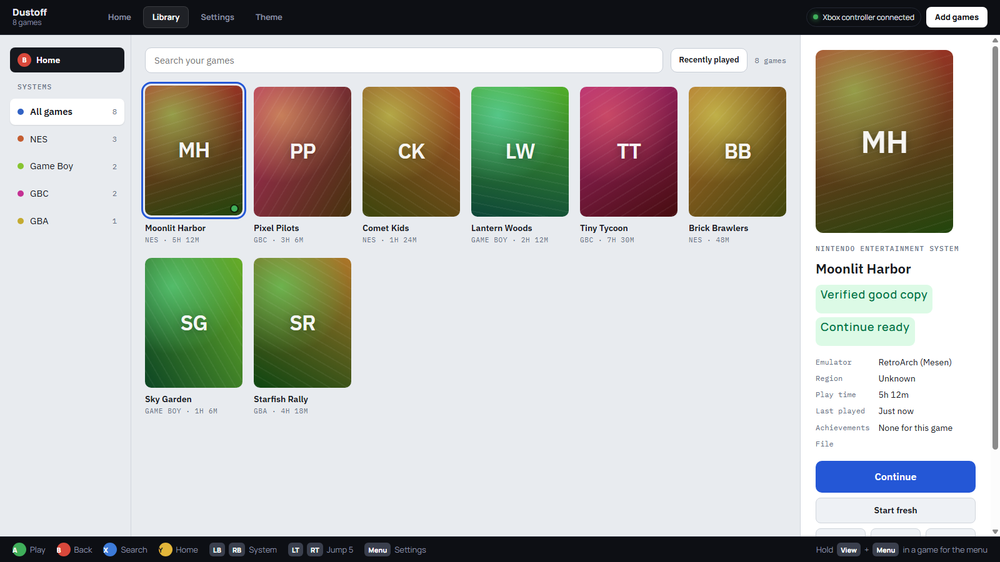

<h1 align="center">Dustoff</h1>

<b>Drag and drop your games in and play.</b> A free, controller-first launcher for classic consoles on Windows. It sets up the emulators for you, so there are no setup screens to fight with.

  <a href="https://github.com/Eshkidu/dustoff/releases/latest/download/DustoffSetup-Public.exe">
    <picture>
      <source media="(prefers-color-scheme: dark)" srcset="screenshots/download-dark.svg">
      
    </picture>
  </a>

v0.1.3 · 329 MB · from <a href="../../releases">GitHub Releases</a> · Free and open source Open the installer, wait about a minute, and Dustoff starts. If Windows says "Windows protected your PC", click <b>More info</b>, then <b>Run anyway</b>.

<table>
  <tr>
    <td></td>
    <td></td>
  </tr>
  <tr>
    <td></td>
    <td></td>
  </tr>
</table>

Screenshots show a sample library with made-up games.

## What it does

- **Drag and drop.** Drop game files, zips or a whole folder onto the window. Each game is recognized, sorted by system and gets its cover art.
- **Controller everywhere.** Menus, search, an on-screen keyboard and an in-game menu (hold View + Menu). Built for Xbox controllers today, with support for PlayStation, Switch Pro, 8BitDo and other controllers coming soon.
- **Your buttons, your way.** Remap any console button per system, or per game.
- **Continue where you left off.** Quitting saves your spot automatically on supported systems.
- **Themes.** Ten original looks inspired by different console eras, each with its own menu sounds.
- **Play time and achievements.** Tracks your hours and supports RetroAchievements.

## Systems

| System                                     | Runs in   | File types                                        |
| ------------------------------------------ | --------- | ------------------------------------------------- |
| NES, SNES, N64                             | RetroArch | .nes .sfc .smc .z64 .n64 .v64                     |
| Game Boy, Game Boy Color, Game Boy Advance | RetroArch | .gb .gbc .gba                                     |
| GameCube, Wii                              | Dolphin   | .iso .rvz .gcm .wbfs                              |
| Wii U                                      | Cemu      | .wua (.wux and .wud need your console's keys.txt) |

## Install

[Download the installer](https://github.com/Eshkidu/dustoff/releases/latest/download/DustoffSetup-Public.exe) (or pick a version from [Releases](../../releases)), double-click it and wait about a minute. Windows may say "Windows protected your PC": click **More info**, then **Run anyway**.

## Your games

Dustoff does not include, link to or download any games, BIOS files, keys or firmware. Use copies of games you own.

## Support the emulators

Dustoff only exists because of these projects. If you'd like to give back, support them directly:

- [RetroArch](https://www.retroarch.com/index.php?page=donate)
- [Dolphin](https://dolphin-emu.org/)
- [Cemu](https://cemu.info/)

## About this code

This repository holds Dustoff's own code (`app/`) and the scripts that build the installer (`tools/`). The emulators are separate programs under their own licenses; see `tools/installer/THIRD-PARTY-NOTICES.txt`.

Dustoff is an independent fan project. It is not affiliated with or endorsed by any console maker.
